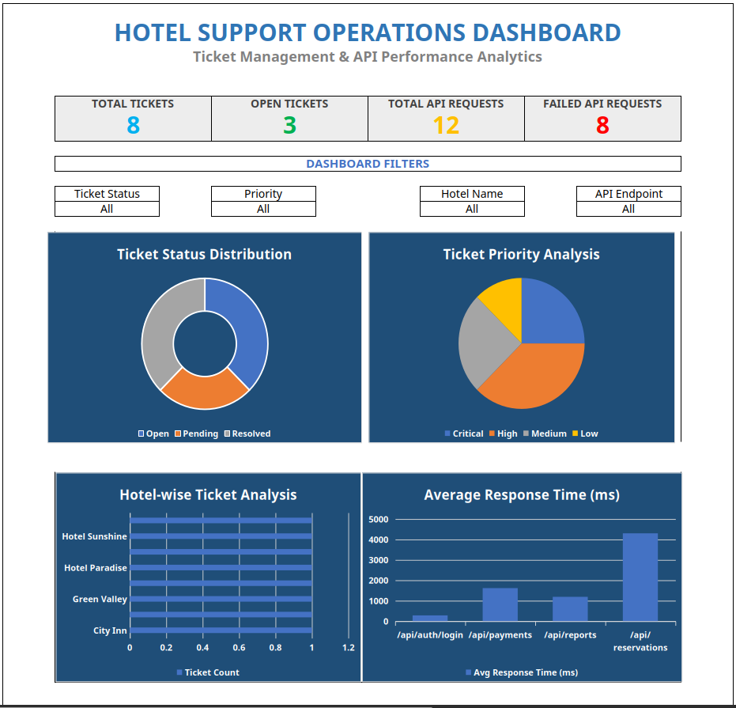

# Hotel Support Operations Dashboard

**An SQL-driven support operations and API monitoring project focused on ticket analysis, incident investigation, SLA tracking, and application performance monitoring.**

Built using **MySQL and Microsoft Excel**, this project demonstrates practical skills relevant to Technical Support, Application Support, Product Support, and Technical Operations roles.

---

## Project Overview

Technical support and application operations teams need to investigate incidents, monitor application health, track service-level agreements (SLAs), and identify recurring technical issues.

This project simulates a support operations environment using sample support tickets and API logs. SQL queries are used to investigate ticket trends, analyze API failures, evaluate response times, and identify potential SLA breaches. The results are presented through an interactive Excel dashboard.

The objective is to demonstrate how database querying and operational reporting can support incident investigation, troubleshooting, and data-driven decision-making.

## Business & Technical Objectives

- Monitor support tickets across different statuses, priorities, issue categories, and hotels.
- Identify high-priority and unresolved support incidents.
- Analyze SLA performance and identify potential SLA breaches.
- Investigate API failures using HTTP response codes and associated ticket records.
- Compare API response times to identify potential application performance bottlenecks.
- Present operational metrics through an interactive dashboard.

## Technology Stack

| Technology | Application |
|---|---|
| MySQL 8 | Relational database management |
| SQL | Incident analysis, joins, aggregations, and SLA calculations |
| MySQL Workbench | Database development and query execution |
| Microsoft Excel | Operational dashboard and reporting |
| PivotTables | Data summarization and analysis |
| Excel Charts & Slicers | Interactive visualization and filtering |

## Project Architecture

The project uses two related datasets stored in MySQL.

### 1. Support Tickets

The `support_tickets` table stores support incident information:

- Ticket ID
- Hotel name
- Issue category
- Issue description
- Priority
- Ticket status
- Creation and resolution timestamps
- SLA hours

### 2. API Logs

The `api_logs` table stores application API activity:

- Log ID
- Associated ticket ID
- API endpoint
- HTTP response code
- Response time in milliseconds
- Log timestamp
- Error message

The relationship between the two tables enables investigation of API failures associated with individual support tickets.

## Key Technical Activities

### 1. Support Ticket & Incident Analysis

- Analyzed ticket distribution by status and priority.
- Identified open, pending, and resolved incidents.
- Examined issue categories and hotel-wise ticket distribution.
- Used conditional SQL logic to classify ticket records.

### 2. SLA Monitoring

- Analyzed ticket creation and resolution timestamps.
- Applied SLA-hour calculations to identify potential SLA breaches.
- Examined ticket resolution status in relation to SLA expectations.

### 3. API Monitoring & Troubleshooting

- Analyzed API request volumes across application endpoints.
- Investigated failed requests using HTTP response codes (4xx and 5xx).
- Compared average response times across endpoints.
- Identified endpoints with elevated failure rates and response latency.

### 4. Database Investigation

- Used SQL joins to correlate support tickets with API logs.
- Applied aggregate functions to summarize operational metrics.
- Used filtering and conditional logic to investigate specific incidents and failure patterns.

## Interactive Operations Dashboard

The Excel dashboard provides a consolidated view of support operations and API performance.

### Dashboard Preview



### Key Performance Indicators

- Total Support Tickets
- Open Tickets
- Total API Requests
- Failed API Requests

### Dashboard Visualizations

- Ticket Status Distribution
- Ticket Priority Analysis
- Hotel-wise Ticket Analysis
- Average API Response Time

### Interactive Filters

The dashboard includes filters for:

- Ticket Status
- Priority
- Hotel Name
- API Endpoint

These filters allow users to investigate operational metrics across different ticket and API dimensions.

## Sample Findings & Observations

The following findings are based on the sample dataset created for this project.

### Support Operations

| Metric | Result |
|---|---:|
| Total Support Tickets | 8 |
| Open Tickets | 3 |
| Pending Tickets | 2 |
| Resolved Tickets | 3 |
| Critical & High Priority Tickets | 5 |

### API Performance

| Metric | Result |
|---|---:|
| Total API Requests | 12 |
| Failed API Requests | 8 |
| API Failure Rate | 66.7% |
| Highest Average Response Time | 4,300 ms |
| Slowest Endpoint | `/api/reservations` |

### Key Observations

- Five out of eight support tickets are classified as Critical or High priority.
- Eight out of twelve API requests returned failure status codes (4xx or 5xx).
- The `/api/reservations` endpoint recorded the highest average response time at 4,300 ms.
- The reservation endpoint also recorded the highest number of failed requests in the sample.
- Correlating API logs with support tickets helps narrow down potential causes during incident investigation.

These observations demonstrate how operational data can help support teams identify issues requiring further investigation and prioritization.

*Note: The project uses a small, simulated sample dataset. The findings are illustrative and do not represent actual production systems or customer incidents.*

## SQL Concepts Demonstrated

- Database and table creation
- Data insertion and retrieval
- Filtering and sorting
- Aggregate functions: `COUNT()`, `AVG()`, and `SUM()`
- Conditional logic using `CASE WHEN`
- Grouping using `GROUP BY`
- Relational joins using `INNER JOIN` and `LEFT JOIN`
- Date and time calculations
- SLA-related conditional analysis
- API failure and response-time analysis

## Repository Structure

```text
support-operations-api-performance-dashboard/
│
├── README.md
│
├── Hotel_Support_Operations_Dashboard.xlsx
│
├── sql/
│   ├── 01_create_database.sql
│   ├── 02_create_tables.sql
│   ├── 03_insert_sample_data.sql
│   └── 04_sql_analysis.sql
│
└── screenshots/
    ├── Dashboard_Preview.png
```

## How to Run the Project

### Prerequisites

- MySQL Server 8 or compatible version
- MySQL Workbench
- Microsoft Excel or Excel Online

### Step 1: Clone the Repository

```bash
git clone https://github.com/harshyelwatkar/hotel-support-operations-dashboard.git
```

### Step 2: Set Up the Database

Open MySQL Workbench and execute the SQL scripts in the following order:

1. `01_create_database.sql`
2. `02_create_tables.sql`
3. `03_insert_sample_data.sql`
4. `04_sql_analysis.sql`

### Step 3: Explore the Dashboard

Open the Excel workbook located in the file structure.

Use the interactive filters and visualizations to explore support ticket metrics and API performance.

## Skills Demonstrated

- Technical Support & Application Support Fundamentals
- Incident and Ticket Analysis
- SQL & Relational Database Management
- API Monitoring and HTTP Status Code Analysis
- SLA Monitoring
- Application Performance Analysis
- Database Troubleshooting
- Operational Reporting
- Microsoft Excel Dashboard Development
- Data Analysis and Visualization
